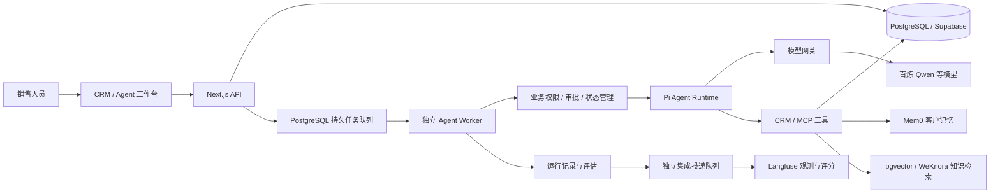

# AI Native CRM

面向客户经营与销售协作的 AI 原生全栈 CRM。系统将客户档案、沟通记录、商机和企业知识连接到 Agent 工作台，帮助销售人员理解客户背景、查找产品依据、形成跟进建议，并通过人工审批执行业务变更。

基于 **Next.js、React、TypeScript 与 Pi Agent** 构建，采用独立 Worker 承载 Agent 长任务，结合 **PostgreSQL / Supabase、Mem0、WeKnora 和 Langfuse**，组织业务数据、长期记忆、知识检索及运行观测。

## 业务场景

- **客户洞察**：汇总客户档案、沟通偏好和确认事实，为销售跟进提供上下文。
- **知识辅助**：检索产品文档、FAQ 和企业 Wiki，返回可追溯的片段、来源与版本信息。
- **商机协作**：围绕商机阶段和销售任务生成操作建议，经过批准后执行，并记录业务结果。
- **执行复盘**：查看任务状态、模型与工具调用、审批回执和评估结果，定位失败原因。

典型流程：**读取客户上下文 → 检索企业知识 → 提出业务动作 → 人工批准 → 执行与续跑 → 观测和评估**。

## 项目亮点

### Pi Agent 与业务执行分层

使用 **Pi Agent Core / Pi AI** 执行模型与工具循环，CRM 业务层负责组织作用域、工具权限、审批和结果约束。模型接入通过统一网关解析组织凭据与供应商配置，支持百炼 Qwen 等模型适配。

### 持久任务与可恢复执行

Web/API 负责交互、鉴权和任务创建，独立 Node.js Worker 消费 PostgreSQL 持久队列。Run、运行事件和恢复状态保存在数据库中，结合任务租约、取消及续跑机制管理执行生命周期；工作台展示过程事件、结果与审批状态。

### 可审查的业务动作

按工具效果区分读取和业务变更，对商机阶段调整等操作生成待确认提案。审批界面展示目标对象与阶段，批准后校验并执行，记录执行回执，并依据结果继续任务或停止等待核对。

### 客户记忆与可信知识

客户确认事实以 CRM 数据库为权威来源，**Mem0** 承担异步记忆投影与辅助检索排序。企业知识结合 **PostgreSQL / pgvector 原生 RAG** 和 **WeKnora Wiki**，保留知识来源、片段、版本和内容哈希；向量检索区分组织与模型身份，避免跨语义空间混用索引。

### 受限多 Agent 协作

提供客户分析、销售运营、客户沟通和监督等内置 Agent。主流程可协调专业子 Agent 做只读调查，汇总结果与证据，并由受控主流程承接业务动作，约束协作过程中的权限和副作用。

### 运行观测与分层评估

SQL 保存运行事实和工具事件，独立集成队列向 **Langfuse** 投递脱敏的模型、工具观测及评分。确定性规则检查执行与引用，按需触发 LLM Judge 做语义复核，将任务完成、执行正确性和回答质量分别呈现。

### 完整工作台与组织权限

基于 React、Radix UI 和 TanStack Query 构建客户管理、商机看板与 Agent 工作台，结合表单校验、图表和流程编辑组件承接业务交互。Supabase Auth、数据库 RLS 与服务端组织/角色校验共同约束数据访问。

## 系统架构

Supabase 提供数据库、认证、文件存储与实时能力。业务事实和任务状态保存在 SQL 中，记忆、知识与观测服务通过适配器按需启用；集成投递与业务任务分别消费。

## 技术栈

| 层次 | 技术与用途 |
| --- | --- |
| 前端框架 | Next.js 16、React 19、TypeScript |
| UI 与交互 | Tailwind CSS 4、Radix UI、TanStack Query、React Hook Form、Zod |
| 可视化 | React Flow、Recharts、商机看板拖拽组件 |
| 后端与任务 | Node.js、Next.js API、独立 Agent Worker、PostgreSQL 持久队列 |
| 数据服务 | Supabase、PostgreSQL、pgvector；Redis 用于可选缓存与运行辅助 |
| Agent 执行 | Pi Agent Core / Pi AI 0.86.1、模型网关、MCP、工具权限与人工审批 |
| 模型与向量 | 百炼 Qwen、text-embedding-v4，以及其他供应商适配 |
| 记忆与知识 | CRM 确认事实、Mem0、原生 RAG、WeKnora |
| 观测与评估 | SQL 运行记录、Langfuse、确定性 Eval、按需 LLM Judge |
| 工程工具 | pnpm、Docker Compose、数据库迁移、Vitest、Testing Library、Playwright、ESLint |

## 运行与演示

运行环境：**Node.js 22+、pnpm、Docker Compose**。Web、Agent Worker 与集成消费者分别运行，并使用一致的组织和服务配置。

- [本地运行与服务管理](docs/local-development.md)
- [销售业务演示](docs/sales-demo.md)
- [记忆、知识与观测服务配置](infra/local-agent-services/README.md)
- [Pi Agent 运行时设计](docs/architecture/pi-native-runtime.md)

## 许可证

本项目采用 [MIT License](LICENSE)。第三方组件及相关声明见 [THIRD_PARTY_NOTICES.md](THIRD_PARTY_NOTICES.md)。
