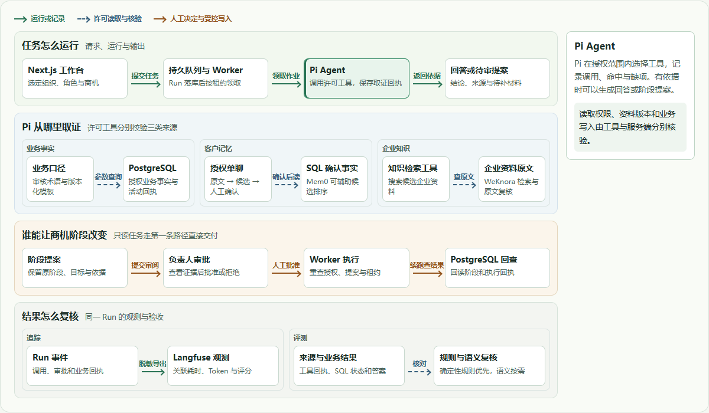

# Pi Native CRM

面向销售团队的 AI 原生 CRM。Agent 从授权范围内的客户会话、商机和企业资料取证，生成带来源的销售建议。负责人决定是否推进，Worker 执行获批动作，再回查实际业务状态。

**[打开在线工作台](https://tech-cove01.github.io/project-crm/workspace/#workbench)** · [项目主页与交互架构](https://tech-cove01.github.io/project-crm/) · [业务与技术详解](https://tech-cove01.github.io/project-crm/details.html)

在线工作台使用浏览器内的合成数据。真实应用的运行方式见[本地启动](#本地启动)。

## 一个销售场景

在合成演示中，栖岭能源的储能站点试点处于「初步接洽」。周谨在会话里提到，夜间告警优先用邮件，紧急故障才打电话。销售还要判断这笔商机能否进入「技术评估」。

- **取证。** Agent 按所选商机和 UTC 时间窗查询已完成约见，找到技术访谈回执 `ACT-1121`，把这条依据带入阶段提案。
- **审批与回查。** 负责人核对依据并决定。待批和待执行时保持原阶段，获批动作执行后由原 Run 回读阶段与回执。
- **跨会话记忆。** 客户偏好带着原话 `MSG-1122` 进入待审候选。确认后，新会话可读取这条已确认事实来准备回访。

[跟做商机审批](https://tech-cove01.github.io/project-crm/demo/index.html?scenario=execution&guide=1#/app/ai/workbench)

## 功能亮点

| 能力                   | 实现                                                                                                                                                              |
| ---------------------- | ----------------------------------------------------------------------------------------------------------------------------------------------------------------- |
| **业务本体与许可查询** | Ontology Lite 用版本化目录解释开放商机、已完成约见等审核口径，绑定组织、对象与时间窗后执行参数化查询。口径不明确时先澄清，结果保留范围与查询依据。                |
| **Pi 运行与人工审批**  | Pi 负责模型与工具循环。PostgreSQL 持久化 Run、队列、提案和执行回执，独立 Worker 按租约领取并续跑。需要交叉核对时，可以用只读专家子任务分别取证。                  |
| **可追溯的客户记忆**   | 获授权的经理或管理员核对原文后确认或驳回候选。受同一客户范围约束，有效的 SQL 事实可跨会话复用，撤回后停止召回。Mem0 可辅助排序，服务异常时仍可使用本地 SQL 事实。 |
| **企业知识与运行复盘** | 原生 RAG 和 WeKnora 支持读取企业资料。引用前核验授权、发布状态、版本与原文。确定性规则检查引用与动作，按需做语义复核。Langfuse 可关联脱敏轨迹、耗时、用量与评分。 |

[商机筛查与审批](https://tech-cove01.github.io/project-crm/details.html#ontology-walkthrough) · [客户记忆提取与确认](https://tech-cove01.github.io/project-crm/details.html#memory-lifecycle)

## 系统架构



工作台和 API 承接登录、业务范围和人工决定。Worker 运行 Pi，模型网关按组织管理供应商凭据与预算。PostgreSQL 保存业务事实、有效记忆和运行状态，外部适配器按需参与记忆排序、企业知识检索或观测。

[在主页查看交互架构图](https://tech-cove01.github.io/project-crm/#architecture) · [运行与审批状态机](https://tech-cove01.github.io/project-crm/#run-states) · [Pi 运行时设计](docs/architecture/pi-native-runtime.md)

## 技术栈

| 层次             | 技术                                                                   |
| ---------------- | ---------------------------------------------------------------------- |
| Web 与交互       | Next.js 16、React 19、TypeScript、Tailwind CSS 4、Radix UI、React Flow |
| API 与异步执行   | Next.js API、Node.js Worker、PostgreSQL 持久队列、SSE                  |
| 数据与身份       | PostgreSQL、Supabase Auth / Storage / Realtime、RLS                    |
| Agent 与模型     | Pi Agent Core / Pi AI 0.86.1、模型网关、MCP，支持百炼 Qwen             |
| 检索、记忆与观测 | pgvector、Mem0、WeKnora、Langfuse                                      |
| 工程             | pnpm、Docker Compose、数据库迁移、Vitest、Playwright                   |

## 本地启动

需要 **Node.js 22+、pnpm 9.15.9 和 Docker**。首次克隆请先按[本地运行文档](docs/local-development.md)准备 Supabase、登录与模型配置。数据库和所需依赖就绪后，在仓库根目录执行以下命令。

```powershell
pnpm install --frozen-lockfile
pnpm local:status
pnpm local:start
```

启动后访问 [本地 Agent 工作台](http://localhost:3000/app/ai/workbench)。结束演示时运行 `pnpm local:stop`，停止受管 Web、Worker 和集成队列消费者，保留数据库和数据卷。

使用已有 Windows 共享工作区时，也可在外层 `agent` 目录双击 `启动_CRM_真实应用.cmd` 或 `关闭_CRM_真实应用.cmd`。独立克隆使用上方仓库内命令。更多步骤见[销售演示手册](docs/sales-demo.md)和[可选集成配置](infra/local-agent-services/README.md)。

## 仓库结构

```text
app/                 Web 页面、API 和工作台
components/          交互界面与共享组件
lib/agent-runtime/   Pi 运行时适配
lib/ontology/        版本化的业务本体目录与许可查询
lib/ai/              Agent 工具、记忆、知识和观测
workers/             独立 Agent Worker
supabase/            数据库迁移与访问策略
infra/               本机容器和可选集成
```

## 许可证

[MIT License](LICENSE) · [第三方声明](THIRD_PARTY_NOTICES.md)
