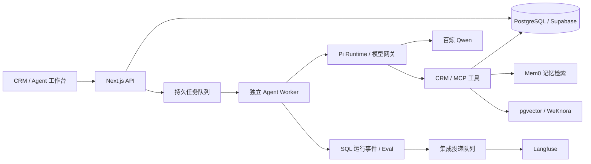

# AI Native CRM

面向销售团队的 AI 原生客户经营与协作系统，将客户档案、沟通偏好、企业知识和商机管理连接到 Agent 工作台，支持客户背景查询、带来源的知识问答，以及经过人工审批的业务操作。

前后端采用 **Next.js 16、React 19 与 TypeScript**，通过 **Pi Agent Core / Pi AI** 驱动模型和工具调用。独立 Worker 承载 Agent 长任务，**PostgreSQL / Supabase** 保存业务事实与运行状态，**Mem0、WeKnora 和 Langfuse** 分别提供记忆检索、企业知识与运行观测能力。

## 核心功能

| 模块 | 功能 |
| --- | --- |
| 客户管理 | 管理客户档案与沟通记录，读取已确认的偏好和事实，为跟进提供上下文 |
| 商机协作 | 通过看板管理销售阶段，提出阶段变更建议，支持批准、拒绝、执行回执与任务续跑 |
| 知识问答 | 查询产品资料、FAQ 和企业 Wiki，展示引用片段、来源与版本信息 |
| Agent 工作台 | 创建任务，查看过程事件、工具调用、结果与待审批动作，支持取消与恢复 |
| 运行复盘 | 查看模型和工具观测、审批记录及评估结果，追溯答案依据与业务变更 |
| 组织权限 | 结合登录身份、组织作用域、角色和知识源授权控制数据与工具访问 |

## 技术栈

| 层次 | 技术与用途 |
| --- | --- |
| 前端 | Next.js 16、React 19、TypeScript、Tailwind CSS 4 |
| 交互与表单 | Radix UI、TanStack Query、React Hook Form、Zod |
| 可视化 | React Flow、Recharts、商机看板拖拽 |
| 后端与任务 | Node.js、Next.js API、独立 Agent Worker、PostgreSQL 持久队列 |
| 数据与认证 | PostgreSQL、Supabase Auth / Storage / Realtime、RLS；Redis 用于可选缓存与运行辅助 |
| Agent 与工具 | Pi Agent Core / Pi AI 0.86.1、模型网关、MCP、工具权限与人工审批 |
| 模型与向量 | 百炼 Qwen、text-embedding-v4、pgvector |
| 记忆与知识 | CRM 确认事实、Mem0、原生 RAG、WeKnora Wiki |
| 观测与评估 | SQL 运行记录、Langfuse、确定性 Eval、按需 LLM Judge |
| 工程工具 | pnpm、Docker Compose、数据库迁移、Vitest、Testing Library、Playwright、ESLint |

## 项目亮点

### Pi Agent 执行与业务约束分层

Pi 负责模型与工具循环，统一模型网关解析组织凭据与供应商配置，接入百炼 Qwen 等模型。CRM 业务层单独管理工具权限、组织作用域和结果约束，让客户查询、知识检索与商机操作共享执行入口，同时保留各自的业务规则。

### PostgreSQL 持久队列与可恢复任务

Web/API 负责交互、鉴权和任务创建，独立 Node.js Worker 消费数据库队列。运行状态、过程事件和恢复状态持久化保存，结合租约、重试、取消与审批续跑管理长任务，工作台通过 SSE 展示执行过程。

### 人工审批与业务结果核对

按工具效果区分读取和业务变更。商机阶段调整先形成待确认提案，展示目标对象与阶段；批准后校验并执行，拒绝时保留原业务状态。执行回执与续跑后的商机读取共同核对结果，使操作建议、审批决定和实际变更可以追溯。

### 确认事实优先的客户记忆与知识检索

客户偏好和确认事实保存在 CRM 数据库，Mem0 承担异步记忆投影与辅助检索排序，最终正文从 SQL 读取。企业知识使用 pgvector 原生 RAG 与 WeKnora Wiki，保留来源、片段、版本和内容哈希；向量索引区分组织与模型身份，Wiki 候选经过授权、发布状态和来源版本复核后才作为证据返回。

### 异步观测与分层评估

SQL 保存运行事实与工具事件，独立集成队列向 Langfuse 投递脱敏的模型、工具观测及评分。确定性规则检查执行状态、审批约束和引用来源，按需调用 LLM Judge 复核语义，将任务是否完成、动作是否正确与答案是否可靠分别评估。

### 全栈工作台与多租户数据访问

客户管理、商机看板和 Agent 交互使用同一套 React 工作台，TanStack Query 管理接口状态与缓存，React Hook Form / Zod 约束表单输入。Supabase Auth、数据库 RLS 与服务端角色、组织和知识源检查共同控制数据访问。

## 系统架构



业务数据、任务与审批状态保存在 SQL 中；记忆、Wiki 和观测通过适配器接入。Web、Agent Worker 与集成消费者分工运行，Mem0、WeKnora 和 Langfuse 按需配置。

## 本地运行

环境要求：**Node.js 22+、pnpm、Docker Compose**，以及数据库、认证和模型配置。

- [本地环境与服务启动](docs/local-development.md)
- [客户、知识与商机审批演示](docs/sales-demo.md)
- [Mem0、WeKnora 与 Langfuse 配置](infra/local-agent-services/README.md)
- [Pi Agent 运行时设计](docs/architecture/pi-native-runtime.md)
- [开发状态与工作记录](docs/STATUS.md)

## 目录

```text
app/          页面、API 与工作台入口
components/   共享界面组件
lib/          CRM 业务、Agent 运行时、工具与集成
workers/      独立 Agent Worker
supabase/     数据库迁移与访问策略
infra/        容器与外部服务配置
docs/         架构、运行说明与开发记录
```

## 许可证

本项目采用 [MIT License](LICENSE)。第三方组件及相关声明见 [THIRD_PARTY_NOTICES.md](THIRD_PARTY_NOTICES.md)。
