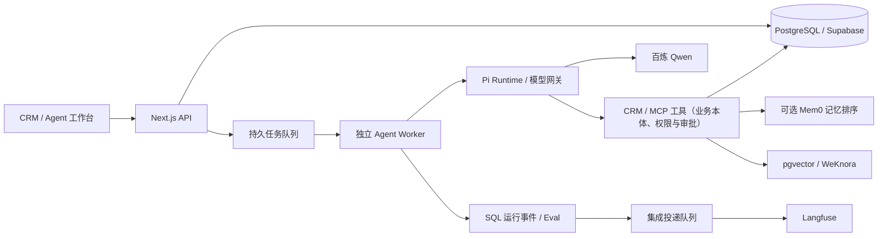

# AI Native CRM

面向销售团队的 AI 原生客户经营与协作系统。销售可以在 Agent 工作台筛选授权管道里的开放商机，核对指定时间内的已完成约见记录，再根据证据决定是否推进某笔商机。授权历史单聊中的客户偏好经人工确认后，可在新会话复用。工作台保留取证依据、审批记录和执行结果，方便销售回查。

[项目展示](https://tech-cove01.github.io/project-crm/) · [业务流程与技术详解](https://tech-cove01.github.io/project-crm/details.html) · [跟做商机审批（静态演示）](https://tech-cove01.github.io/project-crm/demo/index.html?scenario=execution&guide=1#/app/ai/workbench)

## 项目亮点

### Pi 内核与业务本体建模

销售可以问“授权管道里哪些开放商机在指定时间窗内没有已完成约见记录？”其他渠道的跟进情况仍需另行核对。遇到“高潜”或“有效跟进”等缺少审核定义的条件，Agent 会先请销售补充标准。

Pi 负责模型与工具循环。CRM 工具侧的业务本体（Ontology Lite）用版本化目录统一商机、活动及其关系和词义。服务端按审核口径、对象授权和时间窗执行许可查询，并保存可回查的版本与来源。对单笔已选商机，已完成约见记录可成为阶段提案依据。人工批准后由独立 Worker 执行，Agent 续跑并读回实际阶段。拒绝时保留原阶段。

[看商机筛查与口径说明](https://tech-cove01.github.io/project-crm/details.html#ontology-walkthrough)

### 客户记忆提取与跨会话复用

销售可在新会话读到已确认的客户偏好。获授权的经理或管理员从客户历史单聊提取记忆候选，核对原文后确认或驳回。服务端校验引文及来源归属，待审候选不参与召回。重复确认同一候选只写一条事实和一条同步事件。

SQL 保存当前有效事实，读取时核对客户归属和事实状态。撤回后的事实停止召回，更新时先撤回旧事实，再确认新事实。启用 Mem0 时可辅助排序，异常时回退到本地 SQL 事实。

[看记忆提取与确认步骤](https://tech-cove01.github.io/project-crm/details.html#memory-lifecycle)

### 知识检索优化与证据约束

销售可以打开回答引用的企业资料核对出处。项目接入原生 RAG 和 WeKnora Wiki。字面查询没有候选时，WeKnora 可回退到主题词，在限定窗口内按标题与正文排序。返回引用前核验权限、发布状态和版本，已撤回或过期的资料无法继续作为依据。

### Agent 业务评测与运行观测

用同题对照比较单 Agent、三专家及不同记忆方案的任务结果、耗时和 Token 用量。评估时分别核对资料是否找全、回答是否有据、动作是否执行。SQL 记录运行事实，确定性规则检查引用和执行约束，按需使用 LLM Judge 复核答复语义。Langfuse 将脱敏轨迹、模型用量与评分关联起来，便于回查失败发生在哪一步。

## 核心功能

| 模块 | 功能 |
| --- | --- |
| 客户管理 | 管理客户档案与沟通记录，从授权历史单聊提取带引文的记忆候选，支持人审、跨会话读取和撤回 |
| 商机协作 | 通过看板管理销售阶段，按开放商机和已完成约见等审核口径筛查，支持阶段提案、人工审批、执行回执与续跑回查 |
| 知识问答 | 查询产品资料、FAQ 和企业 Wiki，展示引用片段、来源与版本信息 |
| Agent 工作台 | 创建任务，查看业务查询的口径、范围、证据与待审动作，支持取消与恢复；只读专家子任务可分别取证并汇总 |
| 运行复盘 | 查看模型和工具观测、审批记录及评估结果，追溯答案依据与业务变更 |
| 组织权限 | 结合登录身份、组织作用域、角色和知识源授权控制数据与工具访问 |

## 技术栈

| 层次 | 技术与用途 |
| --- | --- |
| 前端 | Next.js 16、React 19、TypeScript、Tailwind CSS 4 |
| 交互与表单 | Radix UI、TanStack Query、React Hook Form、Zod |
| 可视化 | React Flow、Recharts、商机看板拖拽 |
| 后端与任务 | Node.js、Next.js API、独立 Agent Worker、PostgreSQL 持久队列 |
| 数据与认证 | PostgreSQL、Supabase Auth / Storage / Realtime、RLS；Redis 用于可选缓存与运行辅助 |
| Agent 与工具 | Pi Agent Core / Pi AI 0.86.1、模型网关、MCP、工具权限与人工审批 |
| 模型与向量 | 百炼 Qwen、text-embedding-v4、pgvector |
| 记忆与知识 | CRM 确认事实、Mem0、原生 RAG、WeKnora Wiki |
| 观测与评估 | SQL 运行记录、Langfuse、确定性 Eval、按需 LLM Judge |
| 工程工具 | pnpm、Docker Compose、数据库迁移、Vitest、Testing Library、Playwright、ESLint |

## 系统架构



版本化业务本体随 CRM 工具发布。工具识别已审核口径、绑定授权范围并执行参数化查询，工作台通过 SSE 展示取证和执行事件。CRM API 核验客户记忆的引文与来源，收到有权人员确认后才写为 SQL 事实。业务数据、任务、审批与有效客户记忆均以 SQL 为准。

Web、Agent Worker 与集成消费者分工运行。Worker 通过 PostgreSQL 持久队列与租约领取任务，并恢复审批后的运行。Mem0、WeKnora 和 Langfuse 按需配置。模型网关按组织解析可用凭据与供应商配置，Supabase Auth、RLS 和服务端权限检查共同控制数据访问。

## 本地运行

环境要求：**Node.js 22+、pnpm、Docker Compose**，以及数据库、认证和模型配置。

- [本地环境与服务启动](docs/local-development.md)
- [客户、知识与商机审批演示](docs/sales-demo.md)
- [Mem0、WeKnora 与 Langfuse 配置](infra/local-agent-services/README.md)
- [Pi Agent 运行时设计](docs/architecture/pi-native-runtime.md)

## 目录

```text
app/          页面、API 与工作台入口
components/   共享界面组件
lib/          CRM 业务、Agent 运行时、工具与集成
workers/      独立 Agent Worker
supabase/     数据库迁移与访问策略
infra/        容器与外部服务配置
docs/         架构与运行说明
```

## 许可证

本项目采用 [MIT License](LICENSE)。第三方组件及相关声明见 [THIRD_PARTY_NOTICES.md](THIRD_PARTY_NOTICES.md)。
