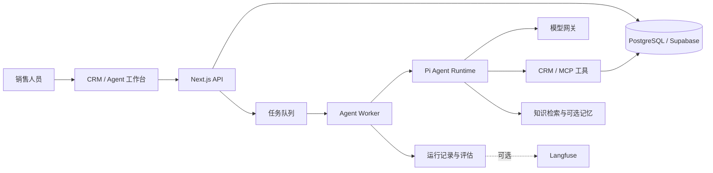

# AI Native CRM

面向跨境销售与客户经营的 AI 原生 CRM。项目将客户、商机、沟通记录和企业知识与 Agent 工作台连接，帮助销售人员查找客户上下文、分析商机、准备跟进，并对涉及业务变更的操作进行审查。

当客户事实散落在会话、客户档案与产品资料中，销售人员不仅需要一个能回答问题的聊天框，还需要能读取业务上下文、解释依据、受权限约束并留下执行记录的助手。这个项目围绕这一任务，结合 CRM 工作台、Agent 执行系统和可插拔的记忆、知识与观测服务。

## 项目亮点

- **面向业务的 Agent 工作台**：以客户、商机和销售操作为上下文，提供客户分析、销售运营、客户沟通和监督等内置 Agent；执行过程中的事件可在工作台查看和回放。
- **可恢复的后台执行**：基于 Pi Agent Core 和独立 Worker 执行模型与工具调用，以 PostgreSQL 保存 Run 和事件、管理任务队列及租约，支持取消、恢复和状态追踪。
- **可审查的工具调用**：区分工具副作用并结合组织、角色与工具权限约束执行；对需要批准的动作提供审批入口和执行回执，让模型建议与实际业务写入之间有明确边界。
- **受限多 Agent 协作**：由主 Agent 协调专业子 Agent 调查客户、资料等问题，子 Agent 以只读调查为主，结果和证据交还主流程，降低协作过程中的副作用。
- **客户记忆与知识检索**：人工确认的客户事实以 CRM 数据库为权威来源，Mem0 可选用于外部记忆投影和辅助排序；企业知识支持 PostgreSQL/pgvector 检索，并可选接入 WeKnora，保留来源、片段或版本信息。
- **运行观测与评估**：在数据库中记录运行与工具事件，提供规则评估和按需触发的 LLM Judge；可选通过 Langfuse 导出脱敏观测信息，用于分析失败和改进流程。

## 架构

Web/API 与 Worker 分工：前者承接产品交互、权限校验和任务创建，后者处理持续执行与恢复。Supabase 提供 PostgreSQL、认证、存储和实时能力；Mem0、WeKnora、Langfuse 和客户渠道按需要配置。

## 技术栈

| 层次 | 技术 |
| --- | --- |
| Web 与交互 | Next.js 16、React 19、TypeScript、Tailwind CSS 4、Radix UI、TanStack Query、React Hook Form、Zod、React Flow、Recharts |
| 后端与数据 | Node.js、Next.js API、独立 Agent Worker、PostgreSQL、Supabase、Redis、pgvector |
| Agent | Pi Agent Core / Pi AI、模型网关、MCP、工具权限与审批、多 Agent 协作 |
| 记忆、知识与观测 | CRM 确认事实、Mem0（可选）、WeKnora（可选）、Langfuse（可选）、规则评估与 LLM Judge |
| 工程化 | pnpm、Docker Compose、数据库迁移、Vitest、Testing Library、Playwright、ESLint |

## 本地运行与验证

需要 Node.js 22 或更高版本、pnpm 及 Docker。数据库、认证与 Worker 的准备步骤见 [本地运行指南](docs/local-development.md)。该指南记录当前机器的运行流程，其他机器首次初始化还需准备所列工具及数据库基线，避免对已有数据库执行重置。

当前已在本机完成依赖安装、类型检查、生产构建、Supabase 初始化、真实登录、核心页面访问，以及合成客户的创建和修改；Worker 的数据库连接和健康检查通过。已接入阿里云百炼 Qwen，并验证客户记忆跨任务读取、合成 FAQ 的向量索引与检索，以及合成商机的审批和执行；客户渠道及可选外部服务仍需单独配置和验证。

## 更多资料

- [能力与实现边界](docs/current-capabilities.md)
- [文档索引](docs/index.md)
- [第三方来源与许可](THIRD_PARTY_NOTICES.md)

项目基于 MIT 许可证发布，详见 [LICENSE](LICENSE)。
