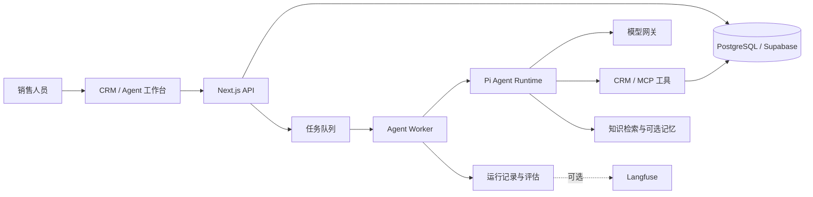

# AI Native CRM

面向跨境销售与客户经营的全栈 AI 原生 CRM。项目将客户、商机、沟通记录和企业知识与 Agent 工作台连接，帮助销售人员查找客户上下文、分析商机、准备跟进，并对涉及业务变更的操作进行审查。

当客户事实散落在会话、客户档案与产品资料中，销售人员不仅需要一个能回答问题的聊天框，还需要能读取业务上下文、解释依据、受权限约束并留下执行记录的助手。这个项目围绕这一任务，结合 CRM 工作台、Agent 执行系统和可插拔的记忆、知识与观测服务。

Web 与 API 使用 Next.js / React / TypeScript，独立 Node Worker 通过 Pi Agent Core 执行模型和工具调用，Supabase/PostgreSQL 保存业务事实、权限与运行记录。项目基于可追溯的上游源码快照；本仓后续接入百炼、修复审批结果语义、补充本机审批续跑模式并完成外部服务联调，详见[来源与本仓改动](docs/current-capabilities.md#继承范围与本仓后续交付)。

## 项目亮点

- **面向业务的 Agent 工作台**：以客户、商机和销售操作为上下文，提供客户分析、销售运营、客户沟通和监督等内置 Agent；执行过程中的事件可在工作台查看和回放。
- **可恢复的后台执行**：基于 Pi Agent Core 和独立 Worker 执行模型与工具调用，以 PostgreSQL 保存 Run 和事件、管理任务队列及租约，支持取消、恢复和状态追踪。
- **可审查的工具调用**：区分工具副作用并结合组织、角色与工具权限约束执行；对需要批准的动作提供审批入口和执行回执，让模型建议与实际业务写入之间有明确边界。
- **受限多 Agent 协作**：由主 Agent 协调专业子 Agent 调查客户、资料等问题，子 Agent 以只读调查为主，结果和证据交还主流程，降低协作过程中的副作用。
- **客户记忆与知识检索**：人工确认的客户事实以 CRM 数据库为权威来源，Mem0 可选用于外部记忆投影和辅助排序；企业知识支持 PostgreSQL/pgvector 检索，并可选接入 WeKnora，保留来源、片段或版本信息。
- **运行观测与评估**：在数据库中记录运行与工具事件，提供规则评估和按需触发的 LLM Judge；可选通过 Langfuse 导出脱敏观测信息，用于分析失败和改进流程。

## 架构

Web/API 与 Worker 分工：前者承接产品交互、权限校验和任务创建，后者处理持续执行与恢复。Supabase 提供 PostgreSQL、认证、存储和实时能力；Mem0、WeKnora、Langfuse 是按需启用的适配器。本机已用合成资料验证这三项服务，客户渠道仍需单独接入与验收。

## 技术栈

| 层次 | 技术 |
| --- | --- |
| Web 与交互 | Next.js 16、React 19、TypeScript、Tailwind CSS 4、Radix UI、TanStack Query、React Hook Form、Zod、React Flow、Recharts |
| 后端与数据 | Node.js、Next.js API、独立 Agent Worker、PostgreSQL、Supabase、Redis、pgvector |
| Agent | Pi Agent Core / Pi AI、模型网关、百炼 Qwen、MCP、工具权限与审批、多 Agent 协作 |
| 记忆、知识与观测 | CRM 确认事实、Mem0（可选）、WeKnora（可选）、Langfuse（可选）、规则评估与 LLM Judge |
| 工程化 | pnpm、Docker Compose、数据库迁移、Vitest、Testing Library、Playwright、ESLint |

## 本机已验证的范围

以下是截至 **2026-10-28** 的本机验收记录，使用合成客户、商机和知识资料，模型请求真实执行并由百炼计费。[中文销售演示](docs/sales-demo.md)采用三个独立任务，最新一次从客户读取到商机审批续跑为 3 分 31 秒，含观测回查为 4 分 29 秒；前序 partial 与评分失败完整保留。该样本不代表生产稳定性，源码中的其他 Agent、Mission 和渠道能力不因此视为全部验收。

| 切片 | 实际结果 | 验收依据与限制 |
| --- | --- | --- |
| 全栈 CRM | 真实登录、核心页面访问、合成客户创建/修改和刷新读取，未登录请求被拒绝。 | [CRM-002b](docs/evidence/CRM-002b.md)；本机独立 Supabase，不代表已部署公网。 |
| Pi Agent 执行 | 工作台创建 Run，经 SQL 队列和独立 Worker 调用 `qwen3.8-flash`、`crm_get_contact`，结果在页面可见。 | [CRM-006](docs/evidence/CRM-006.md)；验证了只读客户查询。 |
| 客户记忆与原生知识 | 人工确认事实写 SQL 并跨 Run 读取；合成 FAQ 经百炼 `text-embedding-v4` 索引、检索并被 Agent 引用。 | [CRM-007](docs/evidence/CRM-007-capabilities.md)；模型和组织隔离已检查，单个样本不代表召回率。 |
| 审批、落库与续跑 | 合成商机变更先生成提案，人工批准后阶段落库，Agent 续跑至 `completed`。 | [CRM-008](docs/evidence/CRM-008.md)；仅在显式本机演示模式下关闭单次金额预算。 |
| Mem0 | 确认事实经专用集成队列自动同步；真实写入、搜索、删除及 Agent 客户工具触发检索通过。 | [CRM-010 Mem0](docs/evidence/CRM-010-mem0.md)；SQL 仍为事实权威，脱敏记录无法确认答案引用了哪条重复记忆。 |
| WeKnora | 百炼处理合成产品资料，CRM 返回带来源的 Wiki 结果，Agent 已引用。 | [CRM-010 WeKnora](docs/evidence/CRM-010-weknora.md)；短查询命中，较长自然语言查询曾返回空结果。 |
| Langfuse 与评估 | 真实回读模型/工具 observations 和确定性评分，重启后记录保留；另已显式运行语义 Judge。 | [CRM-010 Langfuse](docs/evidence/CRM-010-langfuse.md)、[CRM-007](docs/evidence/CRM-007-capabilities.md)；确定性评估出现 `fail`，语义 Judge 为 `needs_review`，均保留原结果。 |
| 固定销售演示 | 最新三 Run completed；批准前阶段不变，执行后重读目标阶段并续跑，三 Trace 实际回读。 | [CRM-014v](docs/evidence/CRM-014v.md)；自动化操作者点击现有 UI，评估仍 needs_review/89、92、89；[前序失败](docs/evidence/CRM-014b.md)保留，未发送客户消息。 |

当前百炼模型费用在 CRM 中仍为未知，不等于免费；演示模式保留组织预算及已有 token/步骤控制，但后两者不是硬上限。客户发送、普通工作台回复候选到批准发送的闭环、组织记忆发布引用和正式成本计算仍未验收，详见[能力与边界](docs/current-capabilities.md)。

## 本地运行

需要 Node.js 22 或更高版本、pnpm 及 Docker。数据库、认证与 Worker 的准备步骤见 [本地运行指南](docs/local-development.md)。该指南记录当前机器的运行流程，其他机器首次初始化还需准备所列工具及数据库基线，避免对已有数据库执行重置。

Web、Worker 与外部集成队列需要分别启动，并加载一致的组织绑定；普通 Worker 的健康检查不能替代集成队列状态检查。组件初始化见[本地服务说明](infra/local-agent-services/README.md)，WeKnora 本机网络适配见[接入说明](docs/weknora-local-development.md)。

验收结果是历史快照，不能据此认定服务此刻在线。Worker 曾无日志退出一次，原因尚未定位；CRM-013 已提供受管启停、只读状态与退出留痕，见[本机恢复证据](docs/evidence/CRM-013c.md)，实际进度以 [STATUS](docs/STATUS.md) 为准。当前优先本机运行与屏幕共享，未部署 Cloudflare/公网服务，也未完成 Linux 2 GiB 环境验证；公网前置见[部署评估](docs/cloudflare-deployment.md)。

## 更多资料

- [实施工作流与状态](docs/STATUS.md)
- [能力与实现边界](docs/current-capabilities.md)
- [上游文档索引（历史资料）](docs/index.md)
- [第三方来源与许可](THIRD_PARTY_NOTICES.md)

项目基于 MIT 许可证发布，详见 [LICENSE](LICENSE)。
