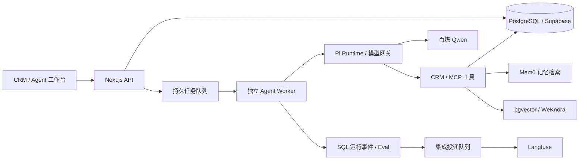

# AI Native CRM

面向销售团队的 AI 原生客户经营与协作系统。选定客户与商机后，销售可以在 Agent 工作台获取带来源的跟进建议。推进商机阶段时，Agent 先提交提案，获批后执行并回查结果，拒绝则保留原阶段。后续会话可以读取已确认的客户偏好，销售也能沿运行记录追查建议依据和执行回执。

[项目展示](https://tech-cove01.github.io/project-crm/) · [业务流程与技术详解](https://tech-cove01.github.io/project-crm/details.html) · [跟做商机审批（静态演示）](https://tech-cove01.github.io/project-crm/demo/index.html?scenario=execution&guide=1#/app/ai/workbench)

## 项目亮点

### Pi 执行与销售审批

销售可以查看阶段变更提案、审批决定、执行回执和商机最新阶段。Pi 负责模型与工具循环，CRM 业务层核验对象、授权和待确认动作。独立 Worker 通过 PostgreSQL 持久队列和租约领取长任务，保存运行状态，为审批后续跑提供依据。工作台通过 SSE 展示过程。

### 跨会话记忆与事实更新

客户确认的预算和沟通偏好可在新会话读取。更新时先撤回旧事实，再确认新事实。SQL 保存当前有效正文，Mem0 辅助排序。读取时核对客户归属和当前记录，避免同名客户的事实串用。Mem0 异常时回退到本地事实。

### 企业知识检索与引用依据

销售可以打开回答引用的企业资料核对出处。项目接入原生 RAG 和 WeKnora Wiki。字面查询没有候选时，WeKnora 可回退到主题词，在限定窗口内按标题与正文排序。返回引用前核验权限、发布状态和版本，已撤回或过期的资料无法继续作为依据。

### 效果对照与运行观测

用同题对照比较单 Agent、三专家及不同记忆方案的任务结果、耗时和 Token 用量。评估时分别核对资料是否找全、回答是否有据、动作是否执行。SQL 记录运行事实，确定性规则检查引用和执行约束，按需使用 LLM Judge 复核答复语义。Langfuse 将脱敏轨迹、模型用量与评分关联起来，便于回查失败发生在哪一步。

## 核心功能

| 模块 | 功能 |
| --- | --- |
| 客户管理 | 管理客户档案与沟通记录，读取已确认的偏好和事实，为跟进提供上下文 |
| 商机协作 | 通过看板管理销售阶段，提出阶段变更建议，支持批准、拒绝、执行回执与任务续跑 |
| 知识问答 | 查询产品资料、FAQ 和企业 Wiki，展示引用片段、来源与版本信息 |
| Agent 工作台 | 创建任务，查看过程事件、工具调用、结果与待审批动作，支持取消与恢复；可由只读专家子任务分别取证并汇总 |
| 运行复盘 | 查看模型和工具观测、审批记录及评估结果，追溯答案依据与业务变更 |
| 组织权限 | 结合登录身份、组织作用域、角色和知识源授权控制数据与工具访问 |

## 技术栈

| 层次 | 技术与用途 |
| --- | --- |
| 前端 | Next.js 16、React 19、TypeScript、Tailwind CSS 4 |
| 交互与表单 | Radix UI、TanStack Query、React Hook Form、Zod |
| 可视化 | React Flow、Recharts、商机看板拖拽 |
| 后端与任务 | Node.js、Next.js API、独立 Agent Worker、PostgreSQL 持久队列 |
| 数据与认证 | PostgreSQL、Supabase Auth / Storage / Realtime、RLS；Redis 用于可选缓存与运行辅助 |
| Agent 与工具 | Pi Agent Core / Pi AI 0.86.1、模型网关、MCP、工具权限与人工审批 |
| 模型与向量 | 百炼 Qwen、text-embedding-v4、pgvector |
| 记忆与知识 | CRM 确认事实、Mem0、原生 RAG、WeKnora Wiki |
| 观测与评估 | SQL 运行记录、Langfuse、确定性 Eval、按需 LLM Judge |
| 工程工具 | pnpm、Docker Compose、数据库迁移、Vitest、Testing Library、Playwright、ESLint |

## 系统架构



业务数据、任务与审批状态保存在 SQL 中。Web、Agent Worker 与集成消费者分工运行，Mem0、WeKnora 和 Langfuse 按需配置。模型网关按组织解析可用凭据与供应商配置，Supabase Auth、RLS 和服务端权限检查共同控制数据访问。

## 本地运行

环境要求：**Node.js 22+、pnpm、Docker Compose**，以及数据库、认证和模型配置。

- [本地环境与服务启动](docs/local-development.md)
- [客户、知识与商机审批演示](docs/sales-demo.md)
- [Mem0、WeKnora 与 Langfuse 配置](infra/local-agent-services/README.md)
- [Pi Agent 运行时设计](docs/architecture/pi-native-runtime.md)

## 目录

```text
app/          页面、API 与工作台入口
components/   共享界面组件
lib/          CRM 业务、Agent 运行时、工具与集成
workers/      独立 Agent Worker
supabase/     数据库迁移与访问策略
infra/        容器与外部服务配置
docs/         架构与运行说明
```

## 许可证

本项目采用 [MIT License](LICENSE)。第三方组件及相关声明见 [THIRD_PARTY_NOTICES.md](THIRD_PARTY_NOTICES.md)。
